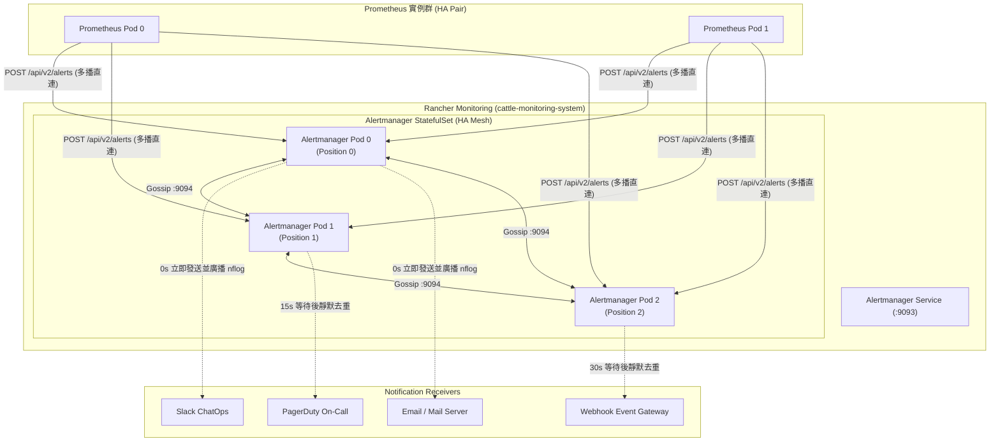
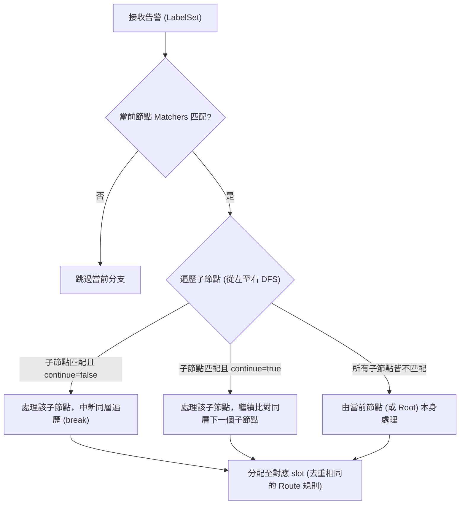
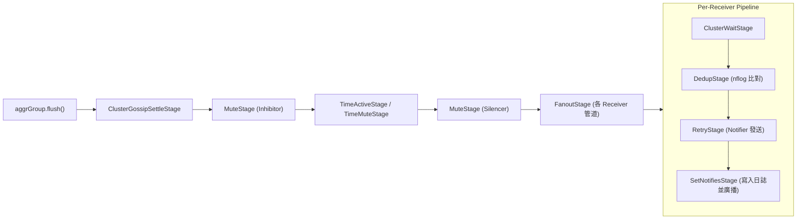
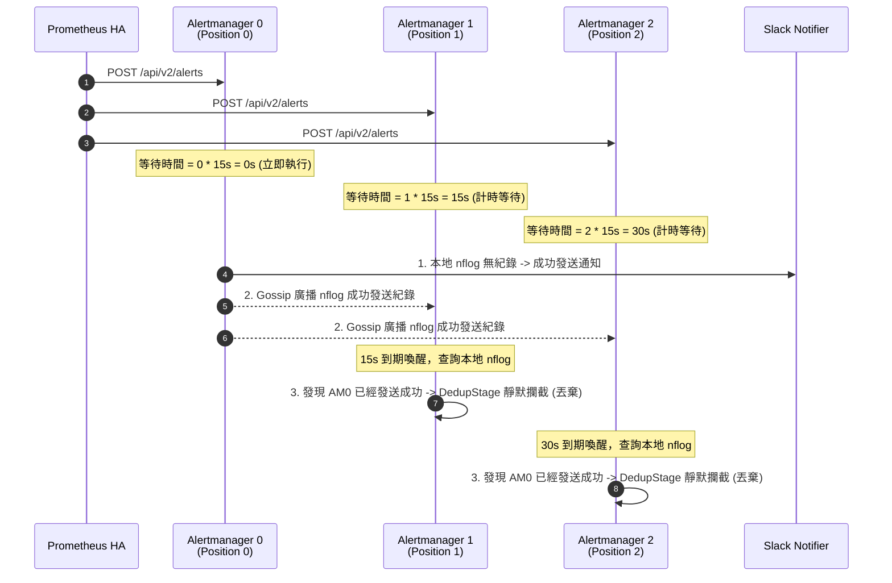
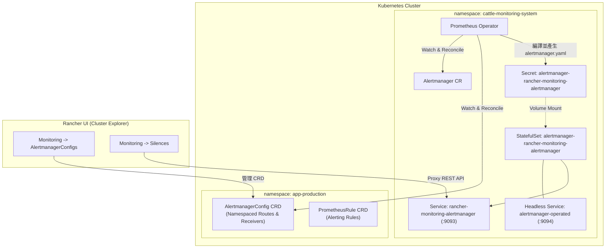
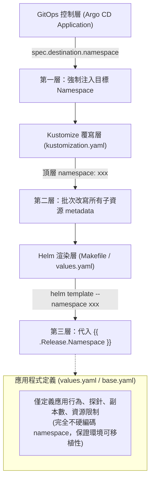

# Prometheus Alertmanager 核心架構設計、高可用 (HA) 叢集實作與 Rancher Monitoring 整合指南

> **互動式視覺化套件 (Archify)**：
> - **單頁互動知識總覽 (Explainer)**：[alertmanager-rancher-explainer.html](file:///home/nathan/Project/alertmanager/docs/alertmanager-rancher-explainer.html)（整合核心結論、內嵌工作流與時序圖、決策矩陣與檢核表）。
> - **系統架構互動圖 (Architecture)**：[alertmanager-architecture.html](file:///home/nathan/Project/alertmanager/docs/alertmanager-architecture.html)（Prometheus HA、Rancher Monitoring 與 Alertmanager 拓撲）。
> - **HA 階梯等待時序圖 (Sequence)**：[alertmanager-ha-sequence.html](file:///home/nathan/Project/alertmanager/docs/alertmanager-ha-sequence.html)（Position 延遲、Gossip 廣播與去重時序動態檢視）。
>
> **官方高可用手冊**：關於叢集啟動旗標與網路考量，亦可參閱本專案源碼文件 [high_availability.md](file:///home/nathan/Project/alertmanager/docs/high_availability.md)。

---

## 1. 架構全景概覽 (System Overview)

在雲原生與微服務監控體系中，**Prometheus** 專注於指標採集與規則評估（Scraping & Rule Evaluation），而 **Alertmanager** 則專職負責告警事件的後續生命週期管理。

當 Prometheus 評估出處於 `firing` 或 `resolved` 狀態的告警時，會透過 HTTP POST 推送給 Alertmanager。Alertmanager 在接收到原始告警後，承擔以下核心職責：
1. **去重 (Deduplication)**：多個 HA 節點發送的相同告警僅保留一份。
2. **分組 (Grouping)**：將屬於相同維度（如同一服務、集群）的相關告警打包為單一通知，防止告警風暴（Alert Storm）。
3. **抑制 (Inhibition)**：根據根因關係（如主機宕機 `NodeDown`），自動過濾衍生告警（如該主機上的 Pod 異常）。
4. **靜音 (Silencing)**：在維護窗口或已知問題期間，基於標籤規則與時間範圍阻斷通知。
5. **路由 (Routing)**：透過樹狀路由層級（Route Tree）與匹配器（Matcher），精準將告警分派至 Slack、PagerDuty、Webhook、Email 等接收端。
6. **無中心高可用叢集 (HA Gossip Mesh)**：各實例間透過 Gossip 協議互聯，同步通知狀態（`nflog`）與靜音資訊，杜絕單點故障（SPOF）。



---

## 2. Alertmanager 核心模組與內部實作解析

從 Alertmanager 源碼模組劃分，可精確對應至以下核心子系統：

```
cmd/alertmanager/  ──> 二進位進入點 (旗標解析與 app 封裝啟動)
app/               ──> 嵌入式運行時生命週期 (setup, reload, 監聽器, clusterWait)
api/v2/            ──> OpenAPI REST API (告警接收、靜音查詢、分組檢視)
provider/mem/      ──> 記憶體告警儲存與生命週期維護 (In-memory Store)
dispatch/          ──> 路由樹遍歷 (Route Tree)、分組槽位 (Slot) 與定時器 (aggrGroup)
notify/            ──> 責任鏈通知流水線 (Pipeline Stages)、去重階段 (DedupStage)
nflog/             ──> 通知歷史日誌 (Protobuf 結構化去重狀態)
cluster/           ──> 基於 Memberlist 的 Gossip HA 叢集同步
inhibit/           ──> 根因告警抑制引擎
silence/           ──> 時間窗口與標籤過濾靜音引擎
```

### 2.1 告警接收與儲存 (`provider/mem` & `api/v2/`)

- **API 接收通道**：Prometheus 透過 `POST /api/v2/alerts` 推送 JSON 陣列。請求由 `api/v2/restapi` 進行驗證，並轉換為內部模型 `types.Alert`。
- **純記憶體儲存**：Alertmanager 內部採用純記憶體管理告警集合（`provider/mem`），每條告警以標籤集合的 64 位元哈希（`Fingerprint`）作為索引 Key。
- **生命週期管理**：記憶體中的過期與已解決告警由背景定時維護協程清除，降低記憶體佔用。

### 2.2 路由樹與匹配器機制 (`dispatch/` & `matcher/`)



#### (1) Matcher 匹配底層原理
位於 `pkg/labels/matcher.go`，Alertmanager 支援四種匹配器：
- `=`（精確相等）、`!=`（不相等）
- `=~`（正則匹配）、`!~`（正則不匹配）

> [!IMPORTANT]
> **正則表達式自動錨定**：源碼在編譯正則匹配器時，會強制套用錨點：
> ```go
> re, err := regexp.Compile("^(?:" + v + ")$")
> ```
> 這意味著 `service =~ "api"` 僅會完全匹配字串 `"api"`，絕不會模糊命中 `"api-gateway"`。如需前綴匹配，務必顯式撰寫為 `service =~ "api.*"`。
> 
> **缺失標籤（Absent Labels）與空字串規則**：未定義的標籤在比對時視同空字串 `""`。因此 `env = ""` 會命中所有未設置 `env` 標籤的告警，而 `env != ""` 則精確過濾出帶有 `env` 標籤且值不為空的告警。

#### (2) Route Tree 遍歷演算法
在 `dispatch/route.go` 的 `match(lset, visit)` 實作中，遍歷機制為**深度優先（DFS）、從上到下（由左至右）**：
- **屬性繼承 (RouteOpts Inheritance)**：子節點自動繼承父節點的 `Receiver`、`GroupBy`、`GroupWait`、`GroupInterval`、`RepeatInterval`、`MuteTimeIntervals`。子節點定義的參數會原地覆蓋繼承值。
- **`continue: true` 控制流**：預設子路由命中後會中斷同層後續搜尋；若啟用 `continue: true`，則允許繼續比對同層兄弟節點，這是實作「主告警送至 PagerDuty，同時抄送一份給 Slack 稽核頻道」的核心配置。
- **Fallback 原則**：若告警符合當前節點，但子節點均未命中，則當前節點即為匹配節點；若無任何子節點匹配，最後由根節點（Root）承接。

#### (3) 槽位去重優化 (`slot`)
若多條路由具有相同的 Key 與完全相等的選項（`RouteOpts.equal`），Dispatcher 會將它們歸納到同一個內部 `slot` 物件，確保同一次告警不會因重複路徑被多餘分組。

### 2.3 告警分組 (`aggrGroup`) 與三大時間參數

Alertmanager 在分組時，會從告警中提取 `group_by` 所指定的標籤集合，並結合所屬路由 Key，計算出全局唯一的 `GroupKey`：
$$\text{GroupKey} = \text{RouteKey} : \text{GroupByLabelSet}$$

每個獨立的 `GroupKey` 對應記憶體中一個獨立運行的狀態機：`aggrGroup`。

```
時間軸 (Timeline) ─────────────────────────────────────────────────────────────>
[t=0s] 告警 A 觸發 (新建 aggrGroup)
  │  (啟動 group_wait 計時器)
  ├─ [t=10s] 告警 B 到達 (同組，靜默聚合存入 store)
  ├─ [t=20s] 告警 C 到達 (同組，靜默聚合存入 store)
[t=30s] group_wait 到期 (30s)
  │  ===> 【第一次通知】 發送批次 [A, B, C]
  │  (將計時器重設為 group_interval)
  │
  ├─ [t=1m] 告警 D 到達 (同組新告警加入)
  │         (不立即發送，等待計時器到期)
[t=5m30s] group_interval 到期 (5m)
  │  ===> 【狀態變更通知】 發送增量批次 (包含 D)
  │  (若後續告警狀態維持不變...)
  │
[t=10m30s] group_interval 到期 (無變化，nflog 比對攔截，不發送)
[t=15m30s] group_interval 到期 (無變化，nflog 比對攔截，不發送)
...
[t=4h5m30s] repeat_interval 到期 (4h)
  │  ===> 【週期提醒通知】 (狀態無變化，但已達 repeat_interval，重新提醒)
```

| 參數名稱 | 建議設定值 | 內部運作機制與架構目的 |
| :--- | :--- | :--- |
| **`group_wait`** | 10s ~ 30s | **初次通知緩衝時間**。<br/>新群組產生時啟動。在緩衝期內吸收同組相繼觸發的告警，合併為單一通知送出，防範雪崩式告警碎片。 |
| **`group_interval`** | 5m | **群組狀態變更時的發送間隔**。<br/>已發出過初次通知後，若有新告警加入該組或既有告警恢復（Resolved），必須等待滿 `group_interval` 才會發送更新批次，防止高頻抖動。 |
| **`repeat_interval`** | 4h ~ 12h | **告警持續存在時的重新發送週期**。<br/>若告警維持 Firing 且標籤集合無任何變化，配合 `nflog` 去重日誌，僅在間隔超過此時間時重新提醒一次。 |

### 2.4 通知處理流水線與去重階段 (`notify/` & `nflog/`)

在 `notify/notify.go` 中，Alertmanager 將發送流程解耦為裝飾者模式的 Stage 流水線：



1. **`ClusterGossipSettleStage`**：在叢集節點剛啟動時暫緩發送，等待成員狀態完成 Gossip 初始同步。
2. **`MuteStage (Inhibitor)`**：比對 `inhibit_rules`。若系統中存在符合條件的根因告警（Source Alert），且當前告警（Target Alert）滿足標籤相等性，則直接剔除。
3. **`TimeActiveStage / TimeMuteStage`**：評估 `time_intervals`（如辦公時間、週末維護），決定是否靜默。
4. **`MuteStage (Silencer)`**：檢查使用者建立的 Silence 規則。
5. **`FanoutStage`**：將告警組分派給各目標接收端（Slack、Webhook 等），進入專屬子階段：
   - **`ClusterWaitStage`**：依據叢集節點排名等待對應延遲（詳見第 3 章）。
   - **`DedupStage`**：查詢 `NotificationLog (nflog)`。若本組告警集合與前次相同且尚未逾期 `repeat_interval`，則標記 `ReasonDoNotNotify` 並直接中斷。
   - **`RetryStage`**：執行外部網路請求（HTTP POST 到 Slack 等），具備指數退避重試能力。
   - **`SetNotifiesStage`**：發送成功後，將時間戳記與告警指紋寫入 `nflog`，並透過 Gossip UDP/TCP 9094 廣播給其他 HA 實例。

---

## 3. Alertmanager 高可用叢集 (HA Cluster) 與去重機制深入剖析

Alertmanager 的高可用設計有別於傳統強一致性系統（如 etcd、Consul 等基於 Raft 的系統），具有獨特的分散式特性。

### 3.1 設計哲學：CAP 定理與「Fail-Open」原則

在監控體系中，**遺漏告警的代價遠高於收到重複告警**。若因網路抖動或叢集無法達成多數決（Quorum）而停止發送告警，將可能導致嚴重的生產事故未被通報。

因此，Alertmanager 做了明確的架構取捨：
1. **AP 模型（可用性 + 分區容忍性）**：放棄強一致性，採用最終一致性（Eventual Consistency）。
2. **無中心節點（Leaderless / Active-Active）**：所有實例均平權對等。沒有 Leader 選舉，因此**不需要維持奇數節點**（2 台、4 台實例皆可正常運作）。
3. **極限容錯度**：一個由 $N$ 個節點組成的叢集，**能容忍 $N - 1$ 個節點宕機**。只要有任一節點存活，通知就能發出。
4. **Fail-Open 原則**：在極端網路分區（Split-Brain）情況下，系統寧可產生重複通知，也保證**至少送達一次（At-least-once delivery）**。

### 3.2 通訊底層：HashiCorp Memberlist Gossip 協議

Alertmanager 使用 [HashiCorp Memberlist](https://github.com/hashicorp/memberlist) 實作 P2P 網狀 Gossip 拓撲：

- **監聽通訊埠**：預設使用 **TCP/UDP 9094**：
  - **UDP**：用於高頻、輕量的節點探測（Probe 心跳，預設每 1 秒）與小型狀態廣播。
  - **TCP**：用於可靠傳輸、節點初次加入握手（Join）以及全量狀態同步（Push-Pull，預設每 60 秒）。
  - *註：若啟用 TLS 傳輸加密，所有 Memberlist 通訊將統一走 TCP 9094。*
- **成員自動發現**：啟動時只需透過 `--cluster.peer` 指向少數種子節點，Memberlist 就會自動拉取並探索整個叢集的所有成員。

### 3.3 狀態同步與 CRDT 合併（nflog 與 silences）

在叢集 Gossip 網路中，主要複製兩類狀態資料（以 Protobuf 格式封裝）：

| 同步狀態 | 檔案路徑與結構 | 衝突解決與合併演算法 |
| :--- | :--- | :--- |
| **`nflog` (Notification Log)** | `data/nflog` (`nflogpb.Entry`) | 記錄每個 Receiver + GroupKey 組合的最後發送時間與告警指紋集合。採用 **最後寫入者勝 (Last-Write-Wins, LWW)**，以最新時間戳記合併。 |
| **`silences` (靜音資料)** | `data/silences` (`silencepb.Silence`) | 使用者在任何節點建立的靜音規則。以 `UpdatedAt` 最新者獲勝。刪除操作本質上是建立一個過期時間為當前的更新（Tombstone）並向外擴散。 |

> [!NOTE]
> **為何原始告警本體不進行 Gossip 同步？**
> Prometheus 每隔一個評估週期（如 15 秒）就會自動將所有 Firing 與 Resolved 告警向 Alertmanager 重新發送。告警本體僅存於各節點本地記憶體，因此完全不需要消耗寶貴的 Gossip 頻寬同步原始告警。

### 3.4 階梯等待去重演算法 (Position-based Staggered Wait)

當多個 Alertmanager 節點同時收到一模一樣的告警時，為了防止每個節點都向接收端發送重複訊息，Alertmanager 設計了精巧的**依位置階梯等待機制**（本節亦提供完整可互動之時序動態圖表：[alertmanager-ha-sequence.html](file:///home/nathan/Project/alertmanager/docs/alertmanager-ha-sequence.html)）。



#### 源碼級運作機制
1. **節點位置排序 (`p.Position()`)**：
   在 `cluster/cluster.go` 中，節點取得當前叢集成員列表，並按照節點名稱的字典序進行排序：
   ```go
   func (p *Peer) Position() int {
       all := p.mlist.Members()
       sort.Slice(all, func(i, j int) bool {
           return all[i].Name < all[j].Name
       })
       // 計算當前節點在有序列表中的索引位置 (0, 1, 2...)
   }
   ```
2. **階梯延遲計算 (`clusterWait`)**：
   在 `app/cluster.go` 中，通知管線在執行發送前會先睡眠一段偏置時間：
   $$\text{WaitDuration} = \text{Position} \times \text{peer\_timeout} \quad (\text{預設 peer\_timeout} = 15\text{s})$$
   - 節點 0（Position 0）：等待 $0 \times 15\text{s} = 0\text{s}$（立即處理發送）。
   - 節點 1（Position 1）：等待 $1 \times 15\text{s} = 15\text{s}$。
   - 節點 2（Position 2）：等待 $2 \times 15\text{s} = 30\text{s}$。
3. **發送與 Gossip 狀態廣播**：
   - 節點 0 最先醒來，查詢 `nflog` 發現無發送紀錄，隨即發送給 Slack。
   - 節點 0 發送成功後，於 `SetNotifiesStage` 寫入本地 `nflog`，並透過 Gossip 廣播給其他節點。
   - 節點 1 在 15 秒後喚醒，查詢 `nflog` 時發現節點 0 剛廣播過來的發送紀錄，判定該告警已發送過，`DedupStage` 直接靜默拋棄。
4. **無縫故障轉移 (Failover)**：
   若節點 0 宕機或外部連線失敗，便無法寫入與廣播 `nflog`。當節點 1 在 15 秒後醒來時，發現本地 `nflog` 依舊沒有這筆發送記錄，**節點 1 便會自動接手發送**，達成毫秒級容錯備援。

### 3.5 狀態沉澱機制 (Gossip Settling)

剛加入叢集或重啟後的 Alertmanager 節點，若立即開始發送通知，會因尚未接收到其他節點廣播的 Silence 或最新的 `nflog` 去重紀錄，導致誤發或重複發送。

為此，Alertmanager 在流水線開頭加入了 **`ClusterGossipSettleStage`**：
- 節點啟動後會先進入「沉澱觀察期」。
- 該演算法會定期檢查叢集成員數量，必須等到**連續 3 次檢查期間成員數保持穩定**（或達到 settle 超時時間）。
- 沉澱期間：節點正常接收並存儲 Prometheus 推送的告警，但**暫緩執行發送流水線**，直到全局拓撲與狀態同步完成。

### 3.6 網路分區與腦裂 (Split-Brain) 處理

當跨機房網路中斷時，Alertmanager 叢集可能會被切分為多個互不連通的孤島：

```
分裂前：
[ AM-1 ] <─── Gossip ───> [ AM-2 ] <─── Gossip ───> [ AM-3 ]

分裂後 (網路分區)：
分區 A: [ AM-1 ] (孤島)      |  分區 B: [ AM-2 ] <───> [ AM-3 ]
```

- **分區 A (AM-1)**：在自身視角中叢集僅剩 1 台，AM-1 成為 Position 0，等待 0 秒 -> **發送告警**。
- **分區 B (AM-2, AM-3)**：AM-2 成為分區內的 Position 0，等待 0 秒 -> **發送告警**；AM-3 為 Position 1，被 AM-2 的 `nflog` 去重。
- **結果**：維運人員會收到 **兩封重複的告警**。
- **網路自癒（Heal）**：當網路分區修復後，Memberlist 自動重新建立連線，兩邊的 `nflog` 與 `silences` 進行 LWW 合併，後續通知立刻恢復為單份發送。

這完全體現了 **Fail-Open** 原則：在無法得知全局狀態的情況下，寧可產生重複通訊，絕不能讓重要警報在分區中被誤殺。

### 3.7 持久化儲存與狀態快照 (Snapshot)

每個 Alertmanager 實例均會定期將記憶體狀態快照寫入磁碟：
- `data/nflog`：通知歷史日誌快照。
- `data/silences`：靜音規則快照。

在節點重啟時：
1. 從磁碟載入本機快照。
2. 加入 Gossip 叢集並與 Peers 進行 Push-Pull 全量狀態合併。
3. 等待 Gossip Settling 完成後恢復對外通知。

> [!CAUTION]
> 在 Kubernetes / Rancher 等容器環境中，**務必為 Alertmanager 掛載 PersistentVolumeClaim (PVC)**。若使用預設的 `EmptyDir`，Pod 重啟時本地快照將徹底遺失；若多個 Pod 同時滾動重啟，可能導致剛被 Silence 的告警再次爆發。

### 3.8 核心黃金法則：Prometheus 嚴禁透過負載均衡器連接

在配置 Prometheus 與 Alertmanager 叢集時，最常見的架構錯誤就是在中間架設 Load Balancer：

- ❌ **錯誤做法**：Prometheus $\rightarrow$ Load Balancer $\rightarrow$ Alertmanager Cluster
  - Prometheus 只會將告警送至隨機一台 Alertmanager，破壞了平行獨立評估機制。
  - Load Balancer 自身成為了單點故障（SPOF）。
  - 若命中處於高延遲或沉澱期的實例，可能引發告警延遲。
- ✔️ **正確做法**：Prometheus $\rightarrow$ **直連所有 Alertmanager 實例**
  ```yaml
  # prometheus.yml
  alerting:
    alertmanagers:
      - static_configs:
          - targets:
              - 'am-1.corp.internal:9093'
              - 'am-2.corp.internal:9093'
              - 'am-3.corp.internal:9093'
  ```

---

## 4. Rancher Monitoring (v2) 整合架構與運作機制

在 SUSE Rancher 2.x 中，監控架構使用 **Rancher Monitoring (v2)**，其底層是基於 `Prometheus Operator` 與 `kube-prometheus-stack` 的深度整合。



### 4.1 核心元件與 Kubernetes 資源對應

| 資源名稱 | 資源類型 | 功能與角色說明 |
| :--- | :--- | :--- |
| **`rancher-monitoring-crd`** | Helm Chart | 安裝 Prometheus Operator 所定義的 CRD（包括 `Alertmanager`, `AlertmanagerConfig`, `PrometheusRule` 等）。 |
| **`rancher-monitoring`** | Helm Chart | 部署 Prometheus Operator、Alertmanager StatefulSet、Grafana、Node-Exporter 等核心控制器。 |
| **`Alertmanager` (CRD)** | Custom Resource | 定義 Alertmanager 的集群規模（`replicas: 3`）、儲存 PVC 配置、版本映像檔與資源限制。 |
| **`AlertmanagerConfig` (CRD)** | Custom Resource | 宣告式（Declarative）定義路由、接收端、抑制與靜音規則。支援全域模式與命名空間專屬模式。 |
| **`alertmanager-rancher-monitoring-alertmanager`** | K8s Secret | Operator 將所有 `AlertmanagerConfig` CRD 與全域設定編譯、驗證後輸出的最終設定檔（`alertmanager.yaml`）。 |
| **`config-reloader`** | Sidecar 容器 | 與 Alertmanager 主容器運行於同一 Pod，監聽 Secret 掛載目錄變更，並自動發送 `POST http://localhost:9093/-/reload` 進行熱重載。 |

### 4.2 命名空間隔離機制 (Namespace Enforcement)

Rancher Monitoring 的多租戶核心在於 `AlertmanagerConfig` 的命名空間隔離：
- 當業務團隊在 `app-production` 命名空間建立 `AlertmanagerConfig` 時，Prometheus Operator 在編譯時會**強制在該配置的所有路由規則中注入標籤過濾**：
  ```yaml
  matchers:
    - name: namespace
      value: app-production
      matchType: "="
  ```
- **資安與穩定性保障**：業務團隊無法透過 CRD 截獲其他專案或全集群層級（如 Node、Etcd、Ingress）的告警，實現了真正的專案級告警自治（Self-service）。

### 4.3 GitOps 部署實踐與 Namespace 注入層級 (Argo CD + Kustomize + Helm)

在實際以 GitOps（如 Argo CD）管理 Rancher 監控系統與自建微服務（如 `gchat-relay` 告警轉發器）時，常有疑問：**「為什麼各 App 目錄下的 `values.yaml` 或資源檔案都沒有特別註明 `namespace`？」**

這是標準雲原生架構中**職責分離（Separation of Concerns）**與**三層注入階層**的體現：



#### (1) 為何 `values.yaml` 絕不硬編碼 Namespace？
- **Chart 可移植性**：`values.yaml` 的職責僅在於提供「應用執行參數」（如探針設定、環境變數、模組定義）。若在 `values.yaml` 中寫死 Namespace，Chart 將無法在 Lab、Stg、Prod 或不同的多租戶環境中重複實例化。
- **Release Context 自動取得**：Helm 範本內部一律使用全域內建變數 `{{ .Release.Namespace }}`，部署時由外層指令或 GitOps 工具動態注入。

#### (2) 三層式 Namespace 注入流水線
1. **第一層：Argo CD Application 層級 (`spec.destination.namespace`)**：
   在 `*.argocd.yaml` 中，宣告該 Application 的目標環境：
   ```yaml
   spec:
     destination:
       namespace: cattle-monitoring-system # 或 gchat-relay
       name: stg
   ```
   Argo CD 在執行同步（Sync）時，會強制將所有未宣告 Namespace 的資源歸入此命名空間。
2. **第二層：Kustomize 層級 (`kustomization.yaml`)**：
   在各環境 Overlay 的 `kustomization.yaml` 宣告：
   ```yaml
   apiVersion: kustomize.config.k8s.io/v1beta1
   kind: Kustomization
   namespace: gchat-relay
   ```
   Kustomize 在建置時，會自動遍歷 `resources` 下的所有 Deployment、Service、ConfigMap，批次補齊 `metadata.namespace`。
3. **第三層：Helm 離線編譯腳本 (`Makefile`)**：
   以 `cattle-monitoring-system` 底下的 `prometheus-blackbox-exporter` 為例，其透過 Makefile 離線渲染靜態清單：
   ```makefile
   helm template prometheus-blackbox-exporter ... \
     --namespace cattle-monitoring-system \
     --values=./values.yaml > prometheus-blackbox-exporter.gen.yaml
   ```
   `values.yaml` 專注於黑箱探針的 modules 設定，Namespace 在渲染階段作為參數傳入，輸出為標準的 `.gen.yaml` 供 Kustomize 與 Argo CD 調度。

#### (3) 跨命名空間告警轉發實務 (Cross-Namespace Webhook)
當 Alertmanager（位於 `cattle-monitoring-system`）需要將告警推送給自建的轉發中繼服務（如位於 `gchat-relay` 命名空間的 Google Chat / Teams Relay 時），應透過 Kubernetes 內部跨命名空間的 CoreDNS FQDN 進行通訊：
```yaml
# cattle-monitoring-system-alertmanagerconfig.yaml
spec:
  receivers:
    - name: 'gchat-relay-webhook'
      webhookConfigs:
        - url: 'http://gchat-relay.gchat-relay.svc.cluster.local:8080/v1/alerts'
          sendResolved: true
```
這種設計既保證了各命名空間的權限隔離與獨立部署，又藉助 K8s 內部 Service 網狀網路實現了低延遲的告警轉發。

---

## 5. 生產環境部署清單 (Production Manifests)

### 5.1 全域 AlertmanagerConfig 範例 (`cattle-monitoring-system`)

此配置適用於平台與 SRE 團隊，包含 Critical 告警多重分發（PagerDuty + Slack）、Warning 告警分流，以及關鍵的**節點宕機抑制規則**：

```yaml
apiVersion: monitoring.coreos.com/v1alpha1
kind: AlertmanagerConfig
metadata:
  name: rancher-global-alertmanager-config
  namespace: cattle-monitoring-system
  labels:
    alertmanagerConfig: rancher-monitoring-alertmanager
spec:
  route:
    groupBy: ['alertname', 'cluster', 'namespace', 'service']
    groupWait: 30s
    groupInterval: 5m
    repeatInterval: 6h
    receiver: 'slack-default'
    routes:
      # 1. 嚴重級別 (Critical)：直通 PagerDuty，並藉由 continue: true 同時抄送 Slack 緊急頻道
      - matchers:
          - name: severity
            value: critical
        receiver: 'pagerduty-urgent'
        continue: true
      - matchers:
          - name: severity
            value: critical
        receiver: 'slack-sre-critical'

      # 2. 警告級別 (Warning)：發送至監控日常告警頻道
      - matchers:
          - name: severity
            value: warning
        receiver: 'slack-warnings'

      # 3. 節點與硬體基礎設施告警：發送至自動化維運 Webhook
      - matchers:
          - name: alertname
            value: "(KubeNodeNotReady|NodeDiskPressure|NodeMemoryHigh)"
            matchType: "=~"
        receiver: 'infra-ops-webhook'

  inhibitRules:
    # 核心根因抑制：節點離線 (KubeNodeNotReady) 時，自動抑制該節點上的所有衍生 Pod 異常
    - sourceMatch:
        - name: alertname
          value: KubeNodeNotReady
      targetMatch:
        - name: alertname
          value: "(TargetDown|KubePodCrashLooping|KubePodNotReady)"
          matchType: "=~"
      equal: ['node', 'instance']

  receivers:
    - name: 'slack-default'
      slackConfigs:
        - channel: '#alerts-general'
          sendResolved: true
          apiURL:
            name: alert-slack-credentials
            key: webhook-url
          title: '{{ template "slack.default.title" . }}'
          text: '{{ template "slack.default.text" . }}'

    - name: 'slack-sre-critical'
      slackConfigs:
        - channel: '#alerts-sre-critical'
          sendResolved: true
          apiURL:
            name: alert-slack-credentials
            key: webhook-url

    - name: 'slack-warnings'
      slackConfigs:
        - channel: '#alerts-warnings'
          sendResolved: true
          apiURL:
            name: alert-slack-credentials
            key: webhook-url

    - name: 'pagerduty-urgent'
      pagerdutyConfigs:
        - serviceKey:
            name: alert-pagerduty-secret
            key: service-key
          sendResolved: true

    - name: 'infra-ops-webhook'
      webhookConfigs:
        - url: 'https://ops-gateway.corp.internal/v1/alerts'
          sendResolved: true
```

### 5.2 業務命名空間專屬 AlertmanagerConfig

業務團隊在 `app-payment` 命名空間自定義通知端點：

```yaml
apiVersion: monitoring.coreos.com/v1alpha1
kind: AlertmanagerConfig
metadata:
  name: payment-team-alerts
  namespace: app-payment
spec:
  route:
    groupBy: ['alertname', 'job']
    groupWait: 15s
    groupInterval: 3m
    repeatInterval: 4h
    receiver: 'payment-webhook'
  receivers:
    - name: 'payment-webhook'
      webhookConfigs:
        - url: 'https://webhook.payment.corp.internal/events'
          sendResolved: true
```

---

## 6. 維運排錯與可觀測性指南 (Operations & Troubleshooting)

### 6.1 告警重複接收的四大排查點

1. **Gossip 通訊埠 (:9094) 受阻**：
   - **現象**：每個 Alertmanager Pod 都各自發送出一份相同的告警。
   - **原因**：Kubernetes NetworkPolicy 或防火牆未放行 Pod 之間的 TCP/UDP 9094 埠，導致去重日誌無法同步。
   - **驗證指令**：
     ```bash
     kubectl exec -it -n cattle-monitoring-system alertmanager-rancher-monitoring-alertmanager-0 -- \
       amtool cluster show --alertmanager.url=http://localhost:9093
     ```
     確認叢集中所有節點狀態均為 `ready`，無 `failed` 節點。
2. **PVC 遺失導致狀態清空**：
   - 預設 Rancher 若使用 `EmptyDir`，Pod 重啟時本機 `nflog` 與 `silences` 會丟失。強烈建議在 `Alertmanager` CR 中設定 StorageSpec 掛載 PersistentVolumeClaim。
3. **`repeat_interval` 設定過短**：
   - 檢查是否將 `repeat_interval` 設成了 5 分鐘，使得正常週期提醒被誤判為重複發送。
4. **跨路由 `group_by` 標籤維度不一致**：
   - 若不同的路由定義了不同的分組維度，告警會被計算出不同的 GroupKey，並在不同的 `aggrGroup` 實例中各自觸發通知。

### 6.2 熱重載與診斷工具流

```bash
# 1. 檢查 config-reloader sidecar 容器日誌
kubectl logs -n cattle-monitoring-system alertmanager-rancher-monitoring-alertmanager-0 -c config-reloader -f

# 2. 檢驗目前載入的最終設定檔
kubectl exec -it -n cattle-monitoring-system alertmanager-rancher-monitoring-alertmanager-0 -c alertmanager -- \
  amtool config show --alertmanager.url=http://localhost:9093

# 3. 測試路由比對 (驗證特定標籤會走向哪一個 Receiver)
kubectl exec -it -n cattle-monitoring-system alertmanager-rancher-monitoring-alertmanager-0 -c alertmanager -- \
  amtool config routes test --alertmanager.url=http://localhost:9093 severity=critical alertname=KubeNodeNotReady
```

### 6.3 關鍵監控指標 (Prometheus Metrics)

| 指標名稱 | 正常預期 | 異常代表意義與因應對策 |
| :--- | :--- | :--- |
| `alertmanager_cluster_members` | 等於副本數 (如 3) | 節點發生分區（Split-Brain）或網路失聯，應檢查 9094 埠。 |
| `alertmanager_cluster_failed_peers` | 0 | 存在失效對等節點，Gossip 同步受阻。 |
| `alertmanager_peer_position` | 0 ~ (Replicas-1) | 當前節點在叢集排序中的位置，決定階梯延遲長度。 |
| `alertmanager_notifications_failed_total` | 0 或極低且不持續增加 | 外部接收端（Slack/PagerDuty/Webhook）網路中斷或 API Token 失效。 |
| `alertmanager_alerts_received_total` | 穩定趨勢 | 數值陡增代表下游集群發生大範圍告警風暴。 |
| `alertmanager_silences{status="active"}` | 符合維護計畫 | 活躍靜音數量過多時，應審核是否有忘記清理的永久靜音。 |

---

## 7. 架構決策與實施建議矩陣 (Architecture Decision Matrix)

```
┌─────────────────────────────────┬─────────────────────────────────┬─────────────────────────────────┐
│ 架構維度                        │ 建議做法                        │ 避免做法                        │
├─────────────────────────────────┼─────────────────────────────────┼─────────────────────────────────┤
│ 高可用性 (High Availability)    │ Replicas >= 3 + 持久化 PVC +   │ 單節點部署；使用 EmptyDir 儲存； │
│                                 │ 開放 TCP/UDP 9094 Gossip 埠     │ 封鎖 Pod 間 9094 網路連線       │
├─────────────────────────────────┼─────────────────────────────────┼─────────────────────────────────┤
│ 負載平衡與連線模式              │ Prometheus 直連所有 AM 節點     │ 在 Prometheus 與 AM 間架設 LB   │
│                                 │ (平行廣播直連)                  │ (破壞獨立評估與容錯架構)        │
├─────────────────────────────────┼─────────────────────────────────┼─────────────────────────────────┤
│ 分組粒度 (Grouping Granularity) │ group_by: [alertname, cluster,  │ group_by: [pod, instance]       │
│                                 │ namespace, service]             │ (粒度過細導致無法聚合降噪)       │
├─────────────────────────────────┼─────────────────────────────────┼─────────────────────────────────┤
│ 時間控制 (Timers)               │ group_wait: 30s                 │ group_wait: 0s                  │
│                                 │ group_interval: 5m              │ (喪失初次告警合併緩衝能力)       │
│                                 │ repeat_interval: 4h ~ 6h        │ repeat_interval: 5m (引發洗版)  │
├─────────────────────────────────┼─────────────────────────────────┼─────────────────────────────────┤
│ 多租戶管理 (Multi-Tenancy)      │ 業務團隊使用專屬命名空間 CRD    │ 所有人共用全域 Secret 進行修改   │
│                                 │ (AlertmanagerConfig)            │ (無權限防護，容易格式錯誤中斷)  │
└─────────────────────────────────┴─────────────────────────────────┴─────────────────────────────────┘
```
